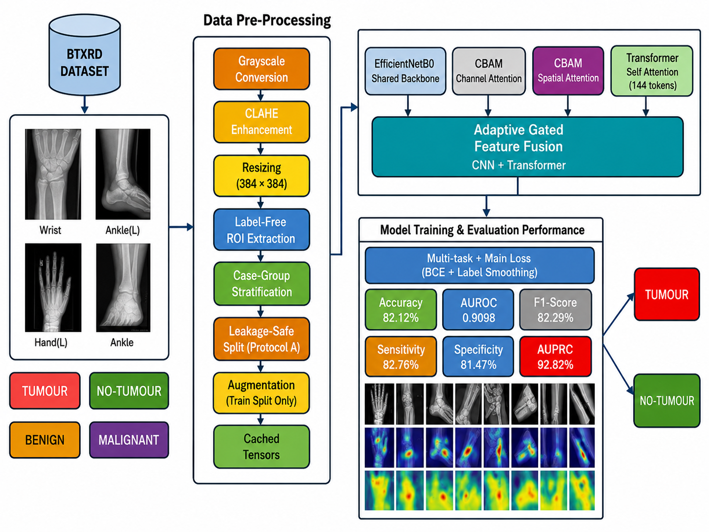

# BT-CAGTNet: Leakage-Safe Bone Tumour Detection on the BTXRD Dataset

Binary classification (**tumour vs no-tumour**) of bone radiographs with a lightweight dual-branch **CBAM-CNN + Transformer** network and adaptive gated fusion. The project focuses on **how trustworthy the reported numbers are**, not only on accuracy: it compares a leakage-safe case-level split with the official image-level protocol and reports both honestly.

## Dataset
- **BTXRD** (bone tumour X-ray radiographs): 3,746 radiographs grouped into 1,318 case groups (grouping reconstructed from metadata).
- Task: binary `tumor` label.
- Please check the dataset's source page for licence and citation before publishing results.
  
## Model architecture: BT-CAGTNet

BT-CAGTNet combines the local texture features of a CNN with the global context of a Transformer, weighted per image by a learned gate. Total: 4.99 M parameter

-Shared backbone: EfficientNet-B0 processes the whole radiograph (single view).
-CBAM: refines backbone feature maps with channel attention (average- and max-pooled MLP) and spatial attention (7x7 convolution).
-Transformer branch: tokenizes the CBAM feature map into 144 patch tokens plus a class token and captures long-range dependencies across the bone.
-Adaptive gated fusion: a small gating network gives a per-image soft weighting, so the model decides how much to trust local convolutional vs global attention evidence.
-Multi-task heads: auxiliary prediction of view, region, bone site, joint involvement and malignancy; each loss is masked to samples where that label exists.
-Segmentation head (optional): a two-layer 3x3 convolutional decoder on the CBAM map (Dice + BCE loss). It was inactive in the reported run, because no pixel-level lesion annotations were available (lambda_seg = 0).
-Ensemble: BT-CAGTNet averaged with a ConvNeXt-Tiny trained on the same recipe, in probability space (threshold re-fitted on validation only).

## Preprocessing

Grayscale, CLAHE (clip limit 2.0, 8x8 tiles), cached at 448x448. An unlabeled bone ROI view (blur, Otsu threshold, morphology, largest component, 1.15x box) is generated without using labels, and is used only as an ablation.

## Training

Automatic mixed precision, gradient accumulation to an effective batch size of 32, fixed seed, early stopping on raw validation AUROC (patience 10, armed after epoch 15). Hard augmentation: CLAHE randomisation, elastic deformation, perspective, solarize, motion blur, Gaussian/Poisson/salt-and-pepper noise, grid shuffle. Case-level split is 70:15:15 with a fixed seed.

## Model: BT-CAGTNet
- Backbone: EfficientNet-B0 (input 384 px, cached at 448 px), 4.99 M parameters in total.
- Two branches (CNN with CBAM attention, and a Transformer branch) combined by **adaptive gated fusion**.
- Multi-task heads with lesion-mask supervision where annotations exist.
- Training: hard augmentation (CLAHE, elastic deformation, perspective, solarize, motion blur, Gaussian/Poisson/salt-and-pepper noise, grid shuffle), early stopping on raw validation AUROC, threshold fitted on validation only.

## Evaluation protocols
| Protocol | Split | Use |
|---|---|---|
| **A** (headline) | Case-level split, leakage-safe | Honest performance |
| **B** | Image-level split (official BTXRD protocol) | Comparable with published BTXRD numbers, **not** leakage-safe |

Under protocol B, 2,512 of 3,746 images (67.1%) sit in case groups that span splits.

## Results (protocol A, test set)
| Model | Accuracy | AUROC |
|---|---|---|
| **BT-CAGTNet + ensemble** | **0.8577** | **0.9299** |
| BT-CAGTNet (proposed, single model) | 0.8115 | 0.9064 |
| ResNet18 + CBAM | 0.8000 | 0.8862 |
| EfficientNetV2-S | 0.7885 | 0.8892 |
| DenseNet121 | 0.7712 | 0.8787 |

- Single model: accuracy 0.8115 (95% CI 0.7769-0.8442), F1 0.8192, AUROC 0.9064 (95% CI 0.8803-0.9307), sensitivity 0.8506, specificity 0.7722.
- Protocol B (image-level) test: accuracy 0.7918, F1 0.7655, AUROC 0.8939.
- 5-fold group cross-validation (protocol A): test accuracy 0.7768 +/- 0.0282, test AUROC 0.8562 +/- 0.0245.

## Ablations (test AUROC)
| Variant | AUROC | Change |
|---|---|---|
| Full model | 0.8899 | n/a |
| - multi-task heads | 0.8869 | -0.0030 |
| + ROI view (dual scale) | 0.8864 | -0.0035 |
| - CBAM | 0.9024 | +0.0125 |
| - Transformer | 0.8846 | -0.0053 |
| + patch-graph branch | 0.8841 | -0.0058 |

Removing CBAM did not hurt here, so its benefit is not supported by this ablation.

## What the project found
- The first runs overfit: the classification head memorised the training images within one epoch, even with the backbone frozen. The fix was structural (fewer branches, smaller embedding, dedicated head dropout) and at the data level (much stronger augmentation).
- Early stopping on a gap-penalised score stopped training at an AUROC maximum, so it was replaced with raw validation AUROC.
- CutMix and constant-fill erasing were removed, because they inject label noise on a small, localised lesion.

## Figures
EDA, preprocessing/ROI, case grouping, split, augmentation, training curves, decision gate, protocol comparison, cross-validation, benchmarks, ablations and explainability (XAI) figures are included as `*.png` files.

## Files
- `bone-cancer-fully-updated.ipynb`: full notebook (data preparation, training, evaluation, ablations, explainability).
- `REPORT.txt`: final text report with all numbers above.
- `*.png`: figures.

## Run
Open the notebook in Google Colab or Kaggle with a GPU runtime and run all cells.

## Limitations
- Case groups are **reconstructed**: BTXRD has no patient identifier, so protocol A is a best-effort reconstruction. It errs toward over-merging, which costs data but cannot create leakage.
- Normal radiographs have no bone-site metadata, so their groups over-merge unrelated patients.
- The segmentation head is supervised only where annotations exist; its IoU is a diagnostic, not a segmentation result.
- Protocol B numbers are comparable with published BTXRD results but must not be presented as leakage-safe.
- Single dataset, no external validation. Not for clinical use.
